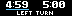
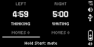

# Chess Clock for BUSY Bar

[](https://github.com/iMalkav/busybar-chess-clock/actions/workflows/ci.yml) [](LICENSE)


A two-player chess clock for [BUSY Bar](https://busy.bar), written in TypeScript
and installed as a JavaScript application.

- Both players' clocks on the front and rear displays.
- Selectable starting player and initial time from 1 to 60 minutes.
- One-button turn switching and move counts.
- Sound cues and a steady indicator for the active player, time pressure and results.
- Saved settings for initial time, first player and sound.

## Screenshots





Captured from a physical BUSY Bar. See [capture details](docs/SCREENSHOTS.md)
for firmware, settings and sample-data provenance.

## Install

Download the `.tgz` package from [Releases](../../releases) and follow
[INSTALL.md](INSTALL.md).

The minimum firmware HTTP API version is specified by `api_version` in
[src/appmeta/manifest.json](src/appmeta/manifest.json).

## Settings

Open **Apps → Chess Clock → Setup** on the BUSY Bar.

| Setting | Purpose |
| --- | --- |
| Time (min) | Initial time for each player, from 1 to 60 minutes |
| First player | Left or right player starts the clock |
| Sound | Enable turn, countdown and result sounds |

Settings are stored by the firmware and loaded when the app starts. The encoder
and OK shortcuts below adjust the current launch without changing these saved
settings.

## Controls

| Input | Before the game | During the game | After the result |
| --- | --- | --- | --- |
| Short Start | Start the selected player's clock | Pass the turn | Reset with the same setup |
| Hold Start | — | Declare checkmate; the active player wins | — |
| OK | Enter or confirm time editing | — | — |
| Encoder | Select the first player; while editing, change both clocks by 1 minute | — | — |
| Back | Exit; while editing, return to the start screen | Reset and return to the start screen | Return to the start screen |

The initial time is set before play. Both displays show tenths of a second
below one minute.
Checkmate is declared by a player through the Start button.

## Development

Use the Node.js version in [.nvmrc](.nvmrc) and the pnpm version in
[package.json](package.json). With Node.js selected:

```sh
git clone https://github.com/iMalkav/busybar-chess-clock.git
cd busybar-chess-clock
corepack pnpm install --frozen-lockfile
corepack pnpm check
```

If the specified pnpm version is installed directly, the `corepack` prefix can
be omitted.

| Command | Result |
| --- | --- |
| `pnpm metadata` | Validate manifest and package versions |
| `pnpm typecheck` | Type-check app, helpers and tests |
| `pnpm test` | Run clock, input, settings, layout and metadata tests |
| `pnpm build` | Build the application directory and `.tgz` package |
| `pnpm smoke` | Check the built package and startup/exit with a mocked API |
| `pnpm check` | Run validation, tests, build and smoke check |
| `pnpm release` | Prepare a versioned archive, checksum and release notes locally |
| `pnpm app:install` / `pnpm app:run` | Install the built package / launch it |
| `pnpm app:stop` / `pnpm app:uninstall` | Stop / uninstall the app |

The build uses `@busy-app/cli` to create `dist/ru.malk-it.chess_clock/` and
`dist/ru.malk-it.chess_clock.tgz`, including scripts, icons, sounds and licenses.
`pnpm build --no-minify` produces readable JavaScript for debugging.

The application calls its device's API through `localhost`. To select a device
for installation or control, pass `--addr <host>` to an `app:` command.

Timing uses `Date.now()` with a 100 ms update interval. Only changed display
elements are sent to the device. Layout and HTTP requests use `@busy-app/busy-lib`.
Host tests use a mocked
device API; physical device checks are listed in the
[release guide](docs/RELEASING.md).

Menu icons can be regenerated with `python scripts/generate-icons.py`.

Two small pnpm patches keep the pinned tooling compatible with the app:
escaped font-map imports on Windows and a guard against cancelling native
timer zero when busy-lib's HTTP time-outs are disabled. Both are applied
automatically by `pnpm install`.

## Releases and contributing

CI runs on Windows and Linux for pull requests and pushes to `main`. A version
tag matching the package and manifest versions triggers a GitHub release with
`ru.malk-it.chess_clock-<version>.tgz` and `SHA256SUMS`. Tags use the manifest
version without a `v` prefix.

See [CONTRIBUTING.md](CONTRIBUTING.md), [docs/RELEASING.md](docs/RELEASING.md)
and [CHANGELOG.md](CHANGELOG.md).

## License

Application code: [MIT](LICENSE). Sound effects retain CC-BY-SA-4.0 and font
metrics retain OFL-1.1. See [THIRD_PARTY_NOTICES.md](THIRD_PARTY_NOTICES.md).

## AI assistance

See [AI_ASSISTANCE.md](docs/AI_ASSISTANCE.md) for the role of AI in this project.
